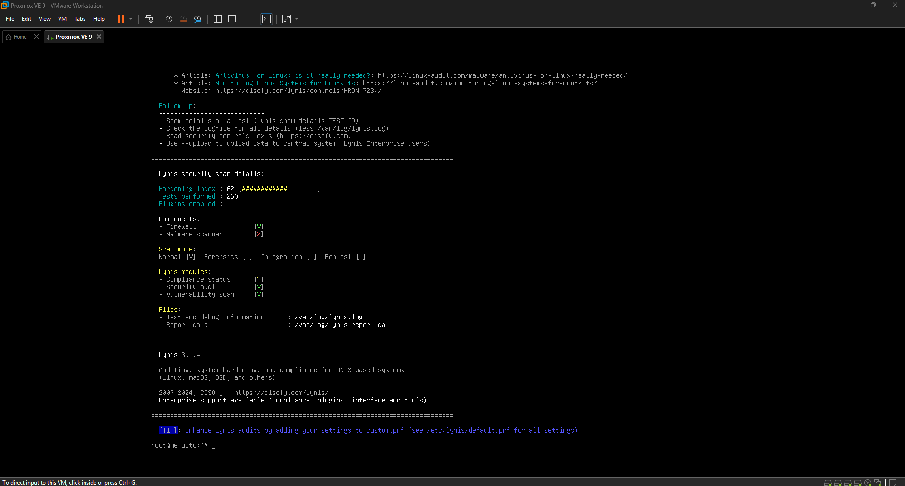
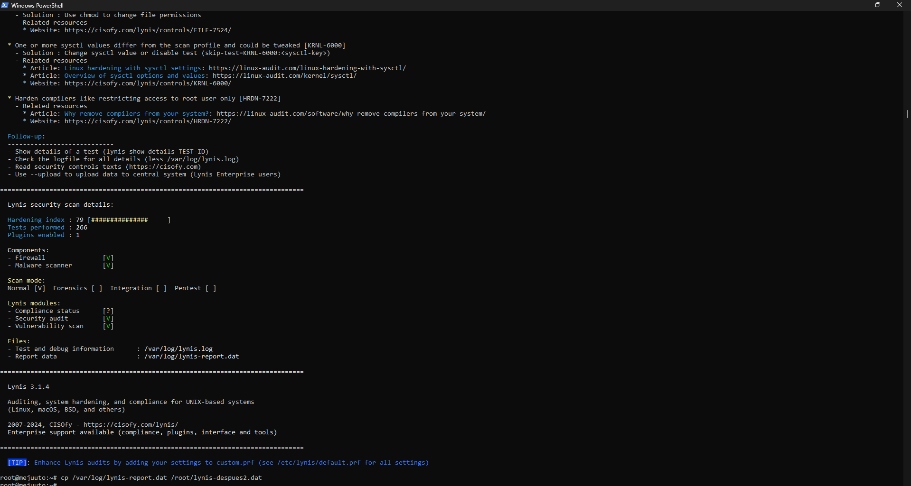
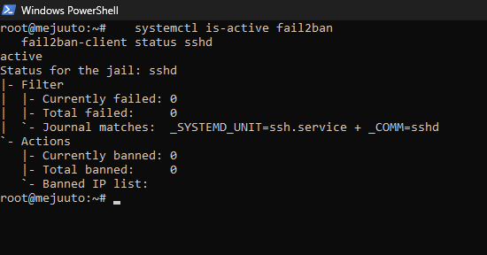
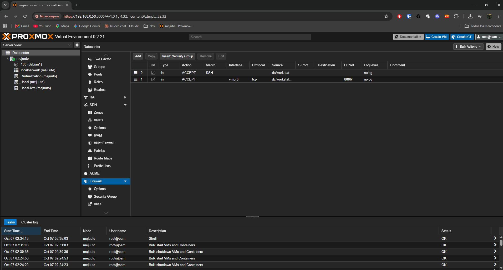
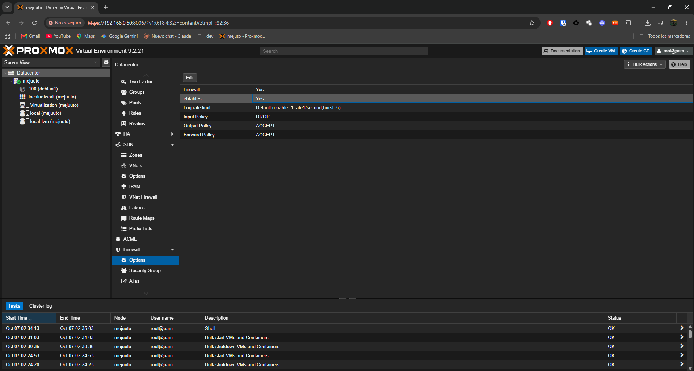

# Homelab con Proxmox VE: instalación, red y hardening

Proyecto de aprendizaje de **Arturo Mejuto** (estudiante del Grado Medio de Sistemas Microinformáticos y Redes) para practicar virtualización, redes Linux y seguridad. Está basado en tutoriales públicos (ver [Fuentes](#fuentes)) y ampliado con mis propias mediciones, decisiones y registro de incidencias.

**Estado:** versión 1 completada (instalación, red, contenedor LXC, hardening medido y firewall). La versión 2 añadirá segmentación de red y monitorización con Wazuh.

> Es un laboratorio de aprendizaje, no un entorno de producción.

## Contenido del repositorio

```
proxmox-homelab/
├── README.md                  este documento
├── docs/configuraciones.md    archivos y comandos del hardening
└── capturas/                  evidencias (Lynis, fail2ban, firewall)
```

## Qué se ha hecho

- Instalación de Proxmox VE sobre VMware Workstation (VM con 4 CPU, 8 GB de RAM y cuatro discos).
- Configuración de red con adaptador puente, repositorios sin suscripción y actualización del sistema.
- Almacenamiento ZFS en un disco dedicado a VMs y contenedores.
- Primer contenedor LXC con Debian 13 sin privilegios.
- Hardening del hipervisor, medido con Lynis: **índice 62 → 79 sobre 100**.
- Firewall de Proxmox con política de entrada `DROP` y acceso de administración limitado a un único equipo.

## Entorno

| Componente | Valor |
| --- | --- |
| Anfitrión | PC con Windows, red 192.168.0.0/24 |
| Hipervisor | VMware Workstation |
| VM de Proxmox | 4 CPU, 8 GB de RAM, virtualización Intel VT-x/AMD-V activada |
| Discos | 80 GB (sistema), 200 GB (VMs y contenedores), 150 GB (datos), 400 GB (copias) |
| Red | Adaptador puente, IP 192.168.0.50/24, gateway 192.168.0.1 |

## Registro de incidencias

Lo más útil de este proyecto: cada fallo con su diagnóstico.

| Síntoma | Causa | Solución |
| --- | --- | --- |
| La web de Proxmox no carga y el ping da timeout | PC en 192.168.0.0/24 y Proxmox en 192.168.2.0/24; la IP venía copiada del tutorial, que usaba la red NAT de VMware | Poner Proxmox en la subred del router |
| Ruta por defecto incorrecta | El gateway apuntaba a la IP del propio PC y no al router | Gateway 192.168.0.1 |
| `ifreload` no aplicaba la red | Al pegar la configuración se perdieron líneas de `/etc/network/interfaces` | Reescribir el archivo con una sola línea `printf` y verificarlo con `cat` |
| La consola de VMware no permite pegar | Limitación de la consola | Configurar la IP a mano con `ip addr` e `ip route` y seguir por SSH |
| Login distinto al del tutorial | Instalé Proxmox Mail Gateway en lugar de Virtual Environment | Descargar la ISO de Proxmox Virtual Environment |
| `no boot filename received` | ISO de arquitectura ARM (arm64) en un anfitrión x86 | Usar la ISO x86 |
| VMware: `The node 0:0 is currently reserved` | Nodo SATA ya ocupado | Elegir otro nodo (SATA 0:1) |
| `REMOTE HOST IDENTIFICATION HAS CHANGED` al conectar por SSH | La nueva instalación reutilizaba la IP de la anterior, con otra huella | Comprobar la huella en el servidor con `ssh-keygen -lf` y borrar la antigua con `ssh-keygen -R` |
| SSH rechazaba la clave (formato incorrecto) | La clave privada estaba en otra carpeta y se usaba la pública | Mover la privada a `.ssh` y ajustar permisos con `icacls` |

## Hardening

Medido con [Lynis](https://cisofy.com/lynis/) 3.1.4.

| Medición | Índice | Medidas aplicadas hasta ese punto |
| --- | --- | --- |
| 1 | 62 | Actualizaciones, usuario propio con 2FA y firewall de Proxmox activo |
| 2 | 70 | SSH solo con clave, con límite de intentos y sesiones y registro detallado, fail2ban, parches automáticos, debsums y needrestart, protocolos de red no usados desactivados, banner de Postfix |
| 3 | 79 | Parámetros de seguridad del kernel (sysctl) y auditoría con auditd y sysstat. `rp_filter` queda en modo laxo (valor 2), distinto del estricto (valor 1) que sugiere Lynis |

Las configuraciones concretas están en [docs/configuraciones.md](docs/configuraciones.md).

### Firewall de Proxmox

- Firewall activo a nivel de Datacenter, con política de entrada en `DROP` (salida y reenvío en `ACCEPT`).
- IPSet `management` con la IP del equipo de administración.
- Reglas de entrada: SSH y TCP 8006, aceptados solo desde ese equipo.
- Prueba: desde el equipo de administración el puerto 8006 responde; desde un contenedor del propio host la conexión da timeout.

### Medidas descartadas y por qué

| Medida | Decisión | Motivo |
| --- | --- | --- |
| `kernel.modules_disabled=1` | Descartada | Impediría cargar módulos y rompería KVM, ZFS y la red de Proxmox |
| Interfaz `nic0` en modo promiscuo | Se mantiene | El puente de red lo necesita para dar red a las VMs |
| Falta de `/vmlinuz` (KRNL-5788) | Falso positivo | Proxmox usa su propio kernel |
| Contraseña de GRUB, `/home` y `/var` separados, bloqueo de USB y firewire | Descartadas | Aportan poco en una VM de laboratorio |
| Caducidad de la contraseña de root | Descartada | Podría dejarme sin acceso |
| Cambiar el puerto SSH | Descartada | Oscurece el servicio pero no lo protege |
| Aviso legal en `/etc/issue` (BANN-7126) | No aplicada | Proxmox usa ese archivo para mostrar la dirección de acceso en la consola |

## Evidencias

| Captura | Qué demuestra |
| --- | --- |
|  | Índice de Lynis de partida |
|  | Índice de Lynis tras el hardening |
|  | fail2ban activo en SSH |
|  | Reglas de entrada limitadas al equipo de administración |
|  | Firewall activo con política de entrada `DROP` |

## Siguientes pasos (versión 2)

- Segmentar la red con un firewall virtual (OPNsense).
- Monitorización con Wazuh, que cubrirá lo que Lynis aún marca: registro externo, integridad de archivos y escáner de malware.
- Dominio con Active Directory.
- Copias de seguridad con Proxmox Backup Server y una restauración probada.

## Fuentes

Proyecto adaptado a partir de tutoriales públicos. Los créditos son de sus autores:

- [«El primer paso para entrar en Ciberseguridad, ¡Que comience nuestro Home Lab!»](https://www.youtube.com/watch?v=Vhi3Kf3HWFg) — mabit
- [«Hardening en Proxmox VE – 10 Pasos CLAVE para Asegurar tu Virtualización»](https://www.youtube.com/watch?v=gQWzmhegZBw) — VM & Cloud Master
- [«Mastering the Proxmox Firewall – What You Need to Know»](https://www.youtube.com/watch?v=CeZkO_hyQEs) — Barmine Tech
